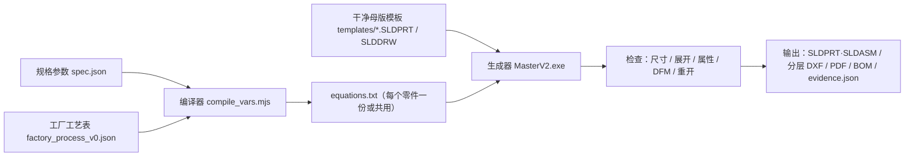

# 项目计划：方案 A+，把工厂工艺做进参数化母版（室内柜 16029）

> 编写：2026-11-12。执行方：Codex。审批：Eli。
> 每轮开始先读：本文件、`data/review_portal_runtime/readonly_open_repair_20261105_1920/PROJECT_GOAL_FINAL_20261108.md`。
> 本计划不替代上述目标文件。两者冲突时以目标文件为准，并按 §8 停下来汇报。

---

## 0. 给 Codex 的执行规则（必读）

1. **按阶段顺序执行**（P0 → P1 → …）。上一阶段的验收没有全部通过，不进入下一阶段。
2. **遇到 §8 的任一卡点，立即停下**：写一份 `BLOCKED_<阶段>_<序号>.md`（格式见 §8.2），然后结束本轮，等 Eli 回复。**不要绕过，不要猜，不要放宽验收标准。**
3. 每个阶段结束都写一份 `RESULT_<阶段>.md`（格式见 §9）。
4. 证据分三档，写法沿用项目惯例：
   - “已验证”：有文件或运行证据；
   - “推断”：依据现有证据的判断；
   - “未验证：缺 […]”：还缺什么证据。
5. **新链路和旧链路完全隔离**：不修改旧链路的任何文件（`tools/lib/locker_16029_*`、`workers/native_model_requests/parametric_v1/*`、门户、工作台）。P9 之前只读旧链路，不改它。
6. 原有硬约束不变（§10）。

---

## 1. 目标与完成标准

### 1.1 目标

做一份**为自动化设计的干净参数化母版**。用两组输入驱动它，自动生成 SolidWorks 三维模型、分层 DXF、工程图和 BOM，对应 `PROJECT_GOAL_FINAL` 的四个目标：

- **规格参数**：宽、高、深、左右列门数、门高序列；
- **工厂工艺表**：材料、板厚、折弯、打标、孔位、焊接定位等。

### 1.2 试点完成标准（P0–P5，到决策点 D1）

以门板为试点。下面全部满足才算完成：

| # | 标准 |
|---|---|
| 1 | 门板母版零件**没有外部引用**，所有驱动尺寸来自全局变量（规格参数 + 工艺表） |
| 2 | 改写外部方程式文件后重建，**不需要任何 repair 步骤**，3 个尺寸 × 左右手全部重建成功 |
| 3 | 基准样本 437 × 471.25 的展开图 = **473.4 × 507.65**（偏差 ≤ 0.01 mm），折弯线 12 条，和已有原生 DXF 一致 |
| 4 | 工艺项随尺寸正确跟随：左右识别缺口、Φ10.2 上下孔（上孔预偏 0.5）、打标 |
| 5 | DXF 按工艺表的图层规范分层导出，`INSUNITS=4`（毫米） |
| 6 | 自定义属性（名称、图号、材料、板厚）由工艺表带出，没有空值 |
| 7 | 单件生成（复制 → 改变量 → 重建 → 检查 → 导出）用时 **≤ 3 分钟** |
| 8 | 门板工程图模板能导出 PDF：原生 SaveAs 返回 errors=0，有轮廓、尺寸、中文和标题栏 |
| 9 | 保存后在**新进程里独立只读重开**，尺寸、展开、属性仍然一致 |

### 1.3 全量完成标准（P6–P10）

- 1000 × 2000 × 500、左 4 右 4 的整机，以及另外 3 组边界尺寸，都能一键生成；
- 生成结果全部通过尺寸、干涉、展开、重开和 DFM 检查；
- 输出整套 DXF、工程图 PDF 和 BOM；
- 门户 5180 可以通过开关切换到新链路。

---

## 2. 背景：为什么换方案

- 旧链路是在工程师手工建的 16029 成品装配上逐个改特征尺寸，例如 `D3@草图18`。这个模型有关联引用、爆炸视图、派生配置和固定门数阵列，尺寸一变就要靠 `repair-*` 阶段去补。
- 截至 11-09：完整试跑 35 分钟，停在第 17 步；出过 22 个修复配置、376 个编译目录；工程图合格 0/4。
- 13 个 C# 文件里没有用到方程式、全局变量或设计表。
- 详细分析见 Eli 收到的《方案评估报告》。本计划是它的执行版。

---

## 3. 项目里可以直接用的资产

> 路径都相对于 `D:\Winnsen_Structure_Agent_Studio\`，除非写了盘符。下表的“用法”一栏说明能不能直接用。**P0 要逐项确认存在并记录 SHA-256**，缺任何一项按 S1 停下。

### 3.1 直接复用（复制或移植代码、按原样读取数据）

| 资产 | 路径 | 内容 | 用法 |
|---|---|---|---|
| 布局与门高分配算法 | `tools/lib/locker_16029_parametric_contract.mjs` | 门宽 `(W-126)/2`、节距预算 `H-87`、门间隙 7、底门 Y=32、按高度或按比例分配门高、左右列独立；各模块 X 坐标（侧板、顶盖、底座、层板、横梁、铰链、锁舌、锁孔） | **复制**到新目录作为 P2 的基础。去掉 `calibration` / `support` 等与旧种子有关的字段，保留几何计算。已有 1 万组算法案例验证 |
| C# 编译方式 | `workers/native_model_requests/parametric_v1/build.mjs` | csc 路径、复制 Interop DLL、生成 SHA 清单 | **照抄模式**，写新的 `build.mjs`，不要引用旧文件 |
| Interop / 编译器 | `D:/soildworks2020/SOLIDWORKS/api/redist`；`C:/Windows/Microsoft.NET/Framework64/v4.0.30319/csc.exe` | SOLIDWORKS 2020 SDK | 直接使用 |
| 离线 API 帮助 | `tmp_chm/`（5355 个 htm） | 重点：`Pack_and_Go_Part_and_Linked_Equation_Example_CSharp.htm`、`Add_Equations_Example_CSharp.htm`、`Get_Equation_Values_Example_CSharp.htm`、`Automatically_Solve_Equations_in_Sequence_Example_CSharp.htm`、`Create_Base-Flange_Feature_Using_Gauge_Table_Example_VB.htm`、`...IBaseFlangeFeatureData~GaugeTablePath.html` | **写任何 API 调用之前先查这里**，不凭记忆写签名 |
| 金标准原始素材 | `workers/analysis/desktop_reference/16029_金标准原始素材_U盘_20260526/` | `1.工程图`（489 个 SLDPRT、148 个 SLDASM、341 个 SLDDRW，含 `储物柜门板1╱12…12╱12.SLDPRT`、门框加强筋等）、`2.钣金展开图`、`3.BOM`、`4.PDF图纸`、`7.车间自制` | **只读**。只能复制到新目录后再“净化”，原文件不动 |
| V35 已验证原生包 | `workers/generated_models/review_generation_requests/v43-int-v35-one-door-one-lock-hole-fix-r1/native_cad/candidate_native_hierarchical_pack_and_go/` | 已验证的原生零件和装配 | 只读，用来对照几何 |
| 八门样本 | `data/parametric_attempts/PARAM-20261107121230852-8D5DE5/package/16029_1000W_2000H_500D.SLDASM` | 1000 × 2000 × 500、双列八门 | 只读，作为 P3/P4 的几何对照基准 |
| 已验证的门板 DXF | `data/review_portal_runtime/readonly_open_repair_20261105_1920/continue20_door_export_20261108/door_tool/native_door_export_run_*/door_left_legacy_none_option0.dxf`（SHA `3C2904AC…D81DC2`）、`door_right_…dxf`（SHA `F69C9D63…5F66109`） | 473.4 × 507.65，12 条折弯线，80 个实体 | **验收基准**（§1.2 第 3 条） |
| DXF 导出与核对代码 | 同目录 `door_tool/NativeDoorFlatDxf20_method1_*.cs`、`MeasurementCopyTools16.cs` | ExportToDWG2 展开导出、INSUNITS、折弯线、闭环检查 | 参考并移植其中的导出和核对函数 |
| 物理检查函数 | `workers/native_model_requests/parametric_v1/NativeParametricPhysicalAudit.cs`、`NativeParametricVerification.cs` | `ExactBounds`、展开捕获、配置激活、重开验证 | **只摘取纯检查函数**，不要搬整个流程 |
| 工艺草稿 | `data/review_portal_runtime/readonly_open_repair_20261105_1920/continue21_drawing_process_20261108/PROCESS_DEFINITION_DRAFT_20261108.md` | t0.8；门板内 R0.2、竖隔板 R0.5；Type4 折弯扣除 1.4；门板与竖隔板展开实测 | P1 工艺表 v0 的数据来源 |
| 工艺核查记录 | `data/production_orders_20261029/continuation_sol_20261029_r5/drawing_template_trial_r1/pdf_export_runs/G_20261104_161342_readonly_audit/工艺体现与图纸问题_只读核查_20261104.md` | 识别缺口（开口 3、深 1.5、R1.5）；Φ10.2 孔、上孔预偏 0.5；层板打标短线；侧板与竖隔板首尾 50 mm 打标、四角 L；样门要求冲突；BOM 属性缺失 | P1 工艺项清单的来源 |
| 打标常量 | `workers/native_model_requests/parametric_v1/NativeParametricProductionMarks.cs` | `PMPrefix="生产打标_焊接定位_"`、`PMShortLeg=3mm`、`PMSideEnd=50mm`、`PMPartitionStandOff=0.5mm`、`PMSideStandOff=0.2mm` | 搬进工艺表，**不要再写成代码常量** |
| 当前工艺说明 | `docs/16029_current_project_process.md` | 当前流程描述 | 背景参考 |
| 可复用手册 | `docs/reusable_playbooks/` | `钣金展开验收流程_20261108.md`、`DXF对比方法_*.md`（3 篇）、`工程图出图流程_Continue21~23`、`工程图毫米单位与关联保持_Continue25`、`工程图PDF字体回退映射_Continue30`、`工程图PDF三项对照验证_Continue31`、`Codex测量工具常见误判_*.md`（2 篇）、`钣金工艺定义模板_Continue21_20261108.md` | 每个对应阶段开始前先读 |
| 现场资料（待确认） | `C:\Users\Administrator\Desktop\图纸与生产环节\`（5 个 PDF）、`C:\Users\Administrator\Desktop\打标的现场图视\`（现场照片） | 可能是工厂工艺和打标的实物依据 | 只读。P1 可以引用，但每一条都要标“待工厂确认” |

### 3.2 只作参考，不复用

| 资产 | 原因 |
|---|---|
| 所有 `repair-*` 阶段、`repairs/readonly-open-*`（22 个配置） | 是为旧母版的缺陷打的补丁，新母版不应该再需要 |
| `NativeParametricEnvelope.cs` / `DoorPlacement.cs` / `Assembly.cs` 的改尺寸流程 | 依赖旧模型的特征名（如 `D3@草图18`） |
| `production-apply`、`NativeParametricProduction*.cs` 流程 | 工艺会在母版里预置，不再后期补加。常量值仍可以参考（见 3.1） |
| 任务授权、哈希固定、租约、发布门禁（`native_task_store`、`execution_authorization`、`production_evidence`） | 试点阶段不用。P9 接入门户时再评估最少需要哪些 |
| `bin-*` 编译目录、`build-*` 生成目录 | 历史编译产物 |

### 3.3 禁止使用或触碰

- R 盘、U 盘；`protected_sources.before.json` 里列出的全部保护源文件，以及 365 份保护源和 3082/166/75 清单；
- 正在运行的门户、worker 和自启任务（P9 之前不停、不重启、不改）；
- README 里提到的 `C:\Users\Administrator\Desktop\参数化模板素材` **已经不存在**，改用 `workers/analysis/desktop_reference/参数化模板素材_U盘原始_20260526/`（只读）；
- 室外柜 22057 的全部内容（目标文件规定暂时搁置）。

---

## 4. 目标架构



### 4.1 新目录（全部新建，和旧链路隔离）

```
workers/master_v2/
  README.md                 本链路说明
  process/                  工艺表 schema、v0 数据、校验脚本
  compile/                  规格 → 变量编译器（来自 parametric_contract 的移植）+ 测试
  cad/                      C# 源码（MasterV2*.cs）、build.mjs
  dfm/                      DFM 规则与检查
  tests/                    无 CAD 单元测试
data/master_v2/             运行产物（不入 Git）
  templates/                干净母版（CAD，不入 Git，单独备份）
  runs/<run_id>/            每次生成：输入、输出、evidence.json、日志
  reports/                  RESULT_*.md、BLOCKED_*.md
```

> [!IMPORTANT]
> P0 要确认 `.gitignore` 已覆盖 `data/master_v2/`、`*.SLDPRT`、`*.SLDASM`、`*.SLDDRW` 和 `workers/master_v2/cad/bin*/`。不确定就按 S2 停下。

### 4.2 生成流程（单件）

1. 把模板复制到 `runs/<run_id>/`（用 Pack and Go，或普通文件复制加引用替换）；
2. 写入该件的 `equations.txt`，母版已设置“链接到外部文件”；
3. 打开文件 → 从外部方程式更新数值 → `ForceRebuild3` → 检查重建错误；
4. 读回关键尺寸，激活展开配置，检查展开外形和折弯线；
5. 检查属性，运行 DFM；
6. 导出分层 DXF，保存，关闭；
7. **在新进程里只读重开**，再核对一遍；
8. 写 `evidence.json`。

---

## 5. 工厂工艺表（P1 的核心产物）

### 5.1 结构（v0 示例，字段可以扩充，**数值只能来自 §3.1 的资料**）

```json
{
  "schema": "winnsen.factory_process.v0",
  "version": "v0-draft-20261112",
  "status": "draft_pending_factory_confirmation",
  "materials": [
    { "id": "SPCC_T0.8", "name": "冷轧钢板", "thicknessMm": 0.8,
      "source": "原始标准BOM Sheet1!J19/K19", "confirmed": false }
  ],
  "bendTable": [
    { "materialId": "SPCC_T0.8", "innerRadiusMm": 0.2, "type": "deduction", "valueMm": 1.4,
      "appliesTo": ["门板"], "source": "PROCESS_DEFINITION_DRAFT_20261108", "confirmed": false },
    { "materialId": "SPCC_T0.8", "innerRadiusMm": 0.5, "type": "deduction", "valueMm": 1.4,
      "appliesTo": ["竖隔板"], "source": "PROCESS_DEFINITION_DRAFT_20261108", "confirmed": false }
  ],
  "features": {
    "doorHandNotch": { "openMm": 3, "depthMm": 1.5, "radiusMm": 1.5, "enabled": true, "confirmed": false },
    "doorHingeHoles": { "diameterMm": 10.2, "upperPreOffsetMm": 0.5, "enabled": true, "confirmed": false },
    "weldLocatorMarks": { "shortLegMm": 3, "endInsetMm": 50, "partitionStandOffMm": 0.5,
                          "sideStandOffMm": 0.2, "layer": "MARK", "enabled": true, "confirmed": false },
    "shelfOldLocatorHoles": { "enabled": false, "note": "生产已取消，见工艺核查记录" }
  },
  "dfm": {
    "minFlangeMm": null, "holeToBendMinMm": null, "maxBlankMm": [null, null], "kerfMm": null
  },
  "dxf": {
    "layers": { "CUT": 7, "BEND_UP": 1, "BEND_DOWN": 5, "MARK": 3, "TEXT": 2 },
    "units": "mm", "includePartNumberText": true, "confirmed": false
  },
  "drawing": {
    "font": "Microsoft YaHei", "sampleDoorRequirement": null
  }
}
```

### 5.2 规则

- `null` 表示还没有数据。**DFM 检查遇到 `null` 时报“未定义”，不判为通过**，也不由 Codex 自己估一个数补上。
- 每条数据必须写明 `source`（来源）和 `confirmed`（工厂是否确认）。所有 `confirmed:false` 的项，都在 `RESULT` 和工程图技术要求里注明“待工厂确认”。
- `dxf.layers` 的颜色和图层名在工厂确认之前只是占位（S4 不阻塞试点，但要记录）。

---

## 6. 分阶段计划

> 每个阶段都按这几项写：**输入 / 任务 / 产出 / 验收 / 本阶段卡点**。时间预算是估计值，超过 2 倍按 S8 停下。

### P0 环境与资产盘点（只读，不改任何文件；0.5 天）

**任务**
1. 确认 SOLIDWORKS 2020 能启动并有授权，记录版本号；确认 Interop DLL 和 csc 存在。
2. 逐项确认 §3.1 的资产存在，记录路径、大小和 SHA-256，写入 `data/master_v2/reports/P0_assets.json`。
3. 确认现在没有 SLDWORKS 进程，也没有正在跑的旧 worker 任务。找到旧链路使用的 **SolidWorks 执行锁**（位置、获取和释放方式），新链路必须共用这把锁，避免两条链同时开 CAD。
4. 在 `tmp_chm` 里查实这些 API 的签名，并写进 `P0_api_notes.md`：
   - 外部方程式：`IEquationMgr.FilePath`、`LinkToFile`、`UpdateValuesFromExternalEquationFile`；
   - 全局变量：`Add2/Add3`、`SetEquationAndConfigurationOption`；
   - 钣金规格表：`GaugeTablePath`、`ISheetMetalFeatureData` 的折弯扣除设置；
   - 展开导出：`ExportToDWG2` 的钣金选项位；
   - DXF 图层映射：`swDxfMappingFiles` 用户选项；
   - `IPackAndGo`；
   - 自定义属性：`ICustomPropertyManager.Add3`。
5. 确认钣金规格表（Excel 格式）在本机能否被 SolidWorks 读取：SW2020 对 xls 规格表可能依赖 Excel 组件。不能读就记下，后面改用路线 B（见 P3）。
6. 确认 `.gitignore` 覆盖范围（见 §4.1）。

**产出**：`P0_assets.json`、`P0_api_notes.md`、`RESULT_P0.md`

**验收**：所有资产存在；锁机制已找到；API 签名都有帮助文档出处。

**本阶段卡点**：SolidWorks 不能启动或没有授权（S1）；资产缺失或 SHA 与 `protected_sources` 记录不一致（S1）；找不到执行锁，或只能修改旧代码才能共用锁（S2）；有正在运行的旧任务（S6，等它结束，不要中断它）。

---

### P1 工厂工艺表 v0 与 DFM 规则定义（不用 CAD；1 天）

**任务**
1. 写 `workers/master_v2/process/schema.json`，结构按 §5.1。
2. 从 §3.1 的工艺草稿、工艺核查记录、打标常量和金标准 `3.BOM` 提取数据，填成 `factory_process_v0.json`，每条写上 `source`。
3. 写校验脚本 `validate_process.mjs`：检查结构；检查数值为正数且有限；`enabled` 的工艺项必须有完整参数；列出所有 `null` 和 `confirmed:false` 的项。
4. 写 DFM 规则清单 `dfm/rules.json`，每条规则写明检查什么、读哪个工艺字段、阈值为 `null` 时的行为：
   - 最小折边；
   - 孔或缺口离折弯线的距离；
   - 展开料尺寸是否超出板料幅面；
   - 每类零件的工艺项是否齐全（门板：缺口 1、上下孔 2、打标 N；侧板：首尾打标）；
   - 属性是否完整，是否和 BOM 一致；
   - 左右手镜像关系。
5. 生成一份“给工厂的确认清单” `FACTORY_REQUEST_v0.md`，内容见 §7，列出每项的当前草稿值，方便工厂逐项确认。
6. 写单元测试。

**产出**：`schema.json`、`factory_process_v0.json`、`validate_process.mjs`、`dfm/rules.json`、`FACTORY_REQUEST_v0.md`、测试、`RESULT_P1.md`

**验收**：校验和测试全部通过；每个数值都能追溯到来源文件和行或段落；没有任何数值是 Codex 自己编的。

**本阶段卡点**：资料之间互相矛盾（例如两份文件给出不同的折弯扣除值），按 S4 停下，列出两个值和各自来源；某个工艺项的用途无法判断（例如 φ4 小凸起），**不要猜**，在工艺表里设为 `enabled:false` 并注明“用途未知”，然后继续，不需要停。

---

### P2 规格 → 变量编译器（不用 CAD；1 天）

**任务**
1. 把 `locker_16029_parametric_contract.mjs` 的几何计算**复制并移植**到 `compile/layout.mjs`，原文件不动。
2. 写 `compile/compile_vars.mjs`：输入 `spec.json` 和工艺表，输出每个零件需要的变量集，以及对应的 `equations.txt` 文本。门板需要的变量包括：
   - `DOOR_W`、`DOOR_H`、`T`、`BEND_R`、`BEND_DED`、`HAND`（L/R）；
   - `NOTCH_*`、`HOLE_D`、`HOLE_PRE_OFFSET`、`MARK_*`；
   - 属性字段。
3. `equations.txt` 的格式**以 P0 查到的帮助文档为准**，并且按这个格式写一个读回解析器。
4. 写测试：
   - 1000 × 2000 × 500、左 4 右 4 → 门宽 437、门高 471.25（`(2000-87)/4-7`）；
   - 边界尺寸：700/1200 宽、1700/2200 高、250/650 深、单列 1 门和 24 门、门高 100 mm 下限；
   - 非法输入要报错拒绝；
   - 移植后的结果要和原 contract 一致（用同一批输入比对输出）。

**产出**：`layout.mjs`、`compile_vars.mjs`、测试、示例 `spec_1000x2000x500_L4R4.json` 及其 `equations.txt`、`RESULT_P2.md`

**验收**：测试全部通过，和原 contract 的结果偏差为 0。

**本阶段卡点**：发现原 contract 的公式和金标准模型实测不一致（S9）。

---

### P3 门板干净母版（用 CAD；2–3 天）⭐ 试点核心

**输入**：金标准门板零件（复制品）、八门样本里的门板（只读对照）、已验证的门板 DXF、P1 工艺表、P2 变量。

**两条建模路线，按顺序尝试，最多两条（规则 S3）：**

- **路线 1：净化金标准门板**
  1. 把 `1.工程图/储物柜门板*.SLDPRT` 中对应 1/12 族的一个文件复制到 `data/master_v2/templates/door/`；
  2. 列出外部引用并断开（`ListExternalFileReferences`，断开或锁定），删除不需要的派生配置，只保留 `Default` 和展开配置；
  3. 加入全局变量，把门宽、门高、孔位、缺口、打标尺寸链接到变量；
  4. 钣金参数链接钣金规格表，或者直接用折弯扣除变量（取决于 P0 第 5 项）；
  5. 方程式链接外部文件 `equations.txt`。
- **路线 2：用 API 重建门板**（路线 1 失败时）：参照金标准门板的几何，用基体法兰、边线法兰、切除、异形孔向导和草图，从零建一个门板模板。这样做的好处是可复现。

**工艺项落地**
- 左右识别缺口：切除特征，尺寸来自 `NOTCH_*` 变量。左右手用 `HAND` 变量控制。优先用方程式控制抑制状态或镜像；如果做不到，就用两个配置，但配置由变量选择。
- Φ10.2 上下孔：孔位 = 公式 + `HOLE_PRE_OFFSET`。
- 打标：放在展开状态下的草图里，图层名使用工艺表的 `MARK`，位置由变量驱动。打标方式按 P0 查到的 DXF 导出能力来定。
- 属性：`名称`、`图号`、`材料`、`板厚`、`表面处理`、`工艺版本` 写成自定义属性，数值来自变量或文本。

**验收**
1. 模板里外部引用数量为 0；重建错误为 0；没有爆炸视图。
2. 用 `equations.txt` 设成 437 × 471.25 后重建：展开 = 473.4 × 507.65（偏差 ≤ 0.01 mm），折弯线 12 条。用 Python 读取 DXF，和已验证的基准 DXF 比较外闭环尺寸和折弯线数量。
3. 再换 2 组尺寸（例如宽 287、高 200；宽 537、高 1000），重建成功，展开满足 `展开 = 折弯态 + 36.4`（这个关系由基准样本推出，属于“推断”，要在 RESULT 里标明）。
4. 左右手各跑一次，缺口位置正确。
5. 保存后在新进程里只读重开，复核第 2 条。

**产出**：`templates/door/门板_母版.SLDPRT`（含 SHA）、建模脚本或操作记录、`evidence.json`、截图（折弯态和展开态）、`RESULT_P3.md`；在 `docs/reusable_playbooks/` 新增《干净母版建模规范_门板》。

> [!IMPORTANT]
> **P3 结束是强制停顿点（S7）**：把模板、截图和验收证据交给 Eli 和结构工程师评审。拿到“通过”之后才进入 P4。

**本阶段卡点**
- 两条路线都失败（S3）；
- 金标准门板和八门样本门板几何不一致，不知道以哪个为准（S4）；
- 展开偏差 > 0.01 mm，并且原因不是工艺表数值（S9）；
- 需要修改原始金标准文件才能继续（S2）；
- 识别缺口或孔的具体位置在资料中找不到（S4）。

---

### P4 生成器与输出（用 CAD；2 天）

**任务**
1. 写 `cad/MasterV2Generator.cs` 和新的 `cad/build.mjs`（编译方式照 §3.1）。命令行：
   `MasterV2.exe generate --template <path> --equations <txt> --process <json> --out <run_dir>`。
   流程按 §4.2。
2. 写 DXF 分层导出：按工艺表 `dxf.layers` 做图层映射，打开 `INSUNITS=4`，导出后用 Python（ezdxf）读回，统计各图层实体数、外闭环尺寸和折弯线数。
3. 执行 DFM 检查：读取 `dfm/rules.json` 和工艺表，结果写进 `evidence.json`。阈值为 `null` 的规则记为 `undefined`。
4. 写 Node 包装 `run_part.mjs`：负责 spec → 编译 → 获取执行锁 → 调用 exe → 释放锁 → 汇总结果。
5. CAD 进程管理：用 `CloseAllDocuments` / `ExitApp` 后**等它自然退出**。超时就记录 PID 并按 S6 停下，**不要强杀**。
6. 跑验收矩阵：3 个尺寸 × 左右手，共 6 次；每次记录耗时。

**验收**：6 次全部通过 §1.2 的第 2–7 条和第 9 条；单件 ≤ 3 分钟；结束后没有残留的 SLDWORKS 或 sldProcMon 进程；模板 SHA 没变。

**产出**：生成器源码、`run_part.mjs`、6 个运行目录、汇总表 `P4_matrix.md`、`RESULT_P4.md`；更新 playbook《DXF 分层导出与核对》。

**本阶段卡点**：图层映射用 API 做不到（S3，两种方法都失败）；保存失败或出现只读错误（S3，**不能**靠关闭只读检查来“通过”）；单件耗时 > 10 分钟（S8）；模板在生成后被改动（S2）。

---

### P5 门板工程图模板与 PDF（用 CAD；1 天）

**任务**
1. 新建门板工程图模板 `templates/door/门板.SLDDRW`：
   - 折弯态主视图加关键尺寸；
   - 展开视图，带折弯方向和顺序注释；
   - 打标说明；
   - 技术要求，链接属性 `$PRP:"..."`；
   - 标题栏，链接零件属性；
   - **文档默认字体（注释、尺寸、表格）设为工艺表 `drawing.font`（微软雅黑），单位用毫米**。
   先读 playbook《工程图出图流程》《工程图毫米单位与关联保持》《工程图PDF字体回退映射》。
2. 生成时把工程图连同零件一起复制，并替换引用（只改副本），然后重建、保存、导出 PDF。
3. 在新进程里只读重开工程图：没有悬空尺寸，引用指向本次运行的零件。
4. 用 P4 的 6 次运行结果各出一张图，并检查 PDF：有矢量轮廓、中文能提取、标题栏字段不为空。

**验收**：§1.2 第 8 条；6 张 PDF 全部合格；原生 SaveAs 的 errors=0。

**本阶段卡点**：改了模板字体后，原生 PDF 仍然报 swGenericSaveError（S3，**不装、不换系统字体**）；工程图引用替换失败（S3）。

---

### 🛑 决策点 D1（强制停顿）

写 `D1_试点总结.md`，内容包括：

- 新旧链路对比：耗时、成功率、需要的修复步骤数量、代码量；
- §1.2 九项标准逐条结论（已验证 / 推断 / 未验证）；
- 工厂确认清单的回复状态；
- 推广到整机的风险和估时。

**然后停下，等 Eli 决定是否进入 P6。**

---

### P6 推广到全部钣金件（每个件族 0.5–1 天）

**件族顺序**：竖隔板 L/R → 侧板 L/R → 横层板 L/R → 门框（上下横、竖）→ 横梁 → 顶盖 → 底座（含加强、地脚）→ 后板 → 加强筋类 → 其余。具体清单以金标准 `3.BOM` 为准，P6 开始前先整理件族表，交 Eli 确认（S7）。

每个件族都按 P3 + P4 的流程做：净化或重建 → 工艺项 → 3 个尺寸验收 → 新进程重开 → 分层 DXF → DFM。

**已知难点（先读证据）**
- 竖隔板：L 的“凸台-拉伸1 / 3 + 阵列4”造成法向跨度 10 mm；R 有 6 个 φ4 凸起，完整实体展开 FAIL。处理方法：在模板中把这些局部构造做成**由工艺表开关控制的特征**。用途不明的，默认按金标准保留，但标“用途未知”，并在 DFM 里单独列出，不算展开失败。**这条处理方式要先交 Eli 确认（S4）**。
- 展开长度公式 `1939.6 = 1856.6 + 83` 只是单样本推断，要用 3 个尺寸验证后才能写进规则。

**每个件族的卡点**：同 P3 和 P4。另外，件族数量多，**每完成 3 个件族交一次 RESULT**。

### P7 骨架与总装（2–3 天）

1. 建骨架零件 `骨架.SLDPRT`：全局变量为整机规格，参考面和草图表达柜体外形、列分隔、每一行门的位置（来自 `layout.mjs` 的 rowsByColumn 和 boundaries）。
2. 总装模板只用**与骨架参考面配合**或固定坐标，不使用关联引用。
3. 门数变化的处理：
   - 每种门高生成一个门板零件文件（同一模板，不同的 `equations.txt`）；
   - 程序按 `rowsByColumn` 插入实例并定位（`AddComponent5` + 配合骨架参考面）；
   - **不使用“删除旧门”这种方式**。
4. 层板和横梁数量 = 门数 − 2（来自 contract），用阵列变量或程序插入实现。
5. 铰链、锁、锁控板等外购件按 contract 坐标插入（只读引用金标准件的副本）。
6. 整机检查：外形尺寸、干涉检查（排除已知的接触配对，规则来自旧 `PhysicalAudit` 的配对清单，只作参考）、所有钣金件展开、新进程重开。
7. 验收矩阵：1000 × 2000 × 500 L4R4；700 × 1700 × 250 L1R1；1200 × 2200 × 650 L12R12；760 × 1917 × 550 L6R3（左右门高不对称）。

**卡点**：干涉无法判断是否允许（S4）；门数超过 20 时性能不达标（单机 > 30 分钟，S8）。

### P8 BOM、整套工程图与交付包（1–2 天）

- BOM：从属性汇总出 Excel 或 CSV（图号、名称、材料、板厚、数量、工艺版本），和 DXF 清单对账，做到一一对应。
- 每个钣金件一张工程图（用 P5 的模式）；再出总装图和尺寸图。
- 交付包：`3D/`、`DXF/`、`PDF/`、`BOM/`、`evidence.json`、`README.txt`（列出工艺版本、待工厂确认项、生成时间）。
- 交付包里**明确写 `production_release=false`**，直到工厂确认工艺表并完成样门验证。

### P9 接入门户 5180（1 天，开始前先停下等 Eli 批准，S7）

- 新增 `master_v2` worker，通过配置开关切换，默认关闭；旧链路保持原样，可以随时切回。
- 门户只增加：选择链路、显示 DFM 和工艺版本、下载新交付包。
- 不停、不重启正在运行的服务。需要重启时，按 S7 停下，等 Eli 安排时间窗口。

### P10 对比报告与旧链路处置建议（0.5 天）

- 写最终报告：四个目标的完成情况、新旧链路数据对比、工厂确认状态、遗留问题。
- 只提出旧链路冻结或归档的**建议**，不执行删除。

---

## 7. 需要工厂提供的输入（P1 生成清单，Eli 负责转交）

1. 材料牌号、表面处理；每种板厚和材料对应的**折弯表**（内 R、V 槽宽度、折弯扣除或 K 因子）
2. 最小折边、孔边距、最大板料或设备幅面、切割补偿
3. **DXF 图层和线型规范**（工厂 CAM 能直接读入的格式），以及是否需要零件号文字
4. 打标规则（哪些件、什么位置、短线还是文字）、焊接定位规范
5. 正反面和左右手的标识方式；折弯方向和顺序在图纸上的表达方式
6. φ4 小凸起、凸台等局部构造的实际用途
7. 工程图标题栏和技术要求的标准格式；样门验证的要求

> 工厂没有回复不阻塞 P1–P5：用 v0 草稿值继续，所有相关输出都标“待工厂确认”。**但 P8 交付包在工厂确认之前不得标为可生产。**

---

## 8. 卡点：何时停下

### 8.1 停止条件（满足任一条就立即停下）

| 编号 | 条件 | 举例 |
|---|---|---|
| S1 | 环境或资产缺失 | SolidWorks 无法启动或没有授权；§3.1 的文件不存在或 SHA 不符 |
| S2 | 需要修改禁止触碰的东西 | 旧链路代码、保护源文件、金标准原件、运行中的服务、R/U 盘、`.gitignore` 不确定 |
| S3 | 同一问题已经试过 2 种方法仍失败 | 净化和重建都不行；两种图层映射方式都失败 |
| S4 | 需要工程或工艺判断 | 两份资料数值冲突；几何以哪个为准不清楚；局部构造用途未知但影响验收；干涉是否允许 |
| S5 | 要通过就必须放宽验收 | 想忽略 SAVE_FAILED、关闭只读检查、把展开偏差阈值放大 |
| S6 | CAD 进程不能自然退出，或有旧任务正在运行 | 超时后进程仍在 |
| S7 | 到了计划规定的停顿点 | P3 结束、D1、P6 开始前的件族表、P9 开始前 |
| S8 | 时间或性能超标 | 阶段用时超过预算 2 倍；单件生成 > 10 分钟；整机 > 30 分钟 |
| S9 | 结果和已有证据矛盾 | 门板展开 ≠ 473.4 × 507.65；移植后的公式结果和原 contract 不一致 |
| S10 | 本计划和 `PROJECT_GOAL_FINAL` 或 Eli 的新指令冲突 | — |

### 8.2 `BLOCKED_<阶段>_<序号>.md` 格式

```markdown
# BLOCKED P3-01
- 停止条件：S3
- 服务目标：目标1/2
- 卡在哪一步：……
- 现象（原文错误或数值）：……
- 已尝试：方法1 …… 结果 ……；方法2 …… 结果 ……
- 证据文件：路径 + SHA
- 当前状态：已回滚 / 未改动任何保护文件 / CAD 进程已自然退出（PID…）
- 需要 Eli 决定：A …… / B …… / C ……（给出推荐项和理由）
```

写完以后**结束本轮**，不要继续做其它阶段的工作。

---

## 9. 每阶段 `RESULT_<阶段>.md` 格式

```markdown
# RESULT P4
- 服务目标：1/2/4
- 本阶段推进：……（对照验收清单逐条：已验证 / 推断 / 未验证：缺 […]）
- 离四个目标还差：……
- 产出文件：路径 + SHA
- 运行数据：耗时、成功率、进程清理情况
- 新增或更新的 playbook：……
- 下一阶段的前置条件是否满足：是 / 否（否就写 BLOCKED）
```

---

## 10. 硬约束（不变）

- 不修改保护源文件（365 份及 3082/166/75 清单）、金标准原件和旧链路代码；不碰 R 盘、U 盘；交付物不放 C 盘。
- 不 push、tag、release、force push、`reset --hard`、amend；可以在本地提交新目录，但提交前列出文件清单。
- 不用 Codex CLI / exec；不委派子代理（这台机器的网关读不了子代理的加密格式，会静默失败）。
- 不强杀 CAD：用 `CloseAllDocuments` / `ExitApp` 后等自然退出；还不行，就用精确 PID 发 `WM_CLOSE`，或用不带 `/F` 的 `taskkill`，并记录 PID、启动时间、是新启动还是附着到已有进程。
- 不放宽任何验收门；不把“推断”写成“已验证”。
- 室外柜项目保持原样不动。
- 模型里工程师留下的细小误差，只做大概判断，不让它影响新母版的定量标准（例如以公式为准，原模型的 ±0.01 mm 级差异记录下来即可）。

---

## 11. 时间估计

| 阶段 | 预算 | 累计 |
|---|---|---|
| P0 | 0.5 天 | 0.5 |
| P1 | 1 天 | 1.5 |
| P2 | 1 天 | 2.5 |
| P3 | 2–3 天（含评审） | 5.5 |
| P4 | 2 天 | 7.5 |
| P5 | 1 天 | 8.5 |
| **D1 试点决策** | — | **约 1.5–2 周** |
| P6 | 约 8–12 个件族 × 0.5–1 天 | +1.5–2.5 周 |
| P7–P10 | 5–7 天 | **全量约 4–6 周** |

> 估时假设工程师能在 P3 和 D1 两个停顿点 1 天内完成评审；工厂回复不阻塞 P5 之前的工作。
